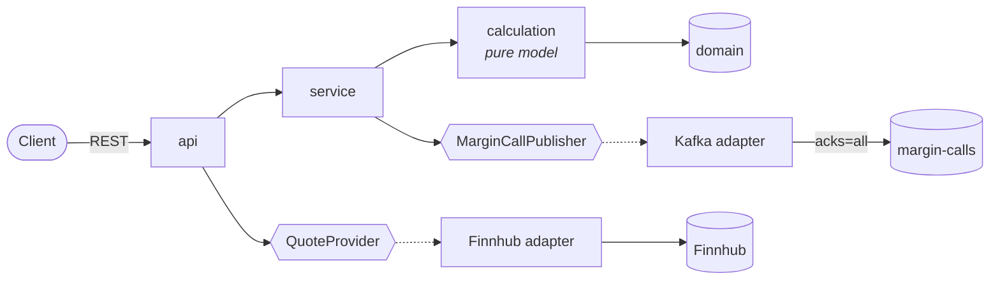

# margin-service

[](https://github.com/cypherz01/margin-service/actions/workflows/ci.yml)


[](#documentation)
[](docs/asyncapi.yaml)

Spring Boot REST service that calculates **margin and collateral requirements** for a portfolio of positions,
and publishes **margin-call events to Kafka** when collateral falls below the maintenance margin.

Built test-first with JUnit 5 and Mockito; integration tests exercise the REST API and Kafka end to end.

## Documentation

| What | Where |
|---|---|
| REST API (OpenAPI 3) | Swagger UI at http://localhost:8080/swagger-ui.html, spec at `/v3/api-docs` |
| Kafka events (AsyncAPI 3) | [`docs/asyncapi.yaml`](docs/asyncapi.yaml) (paste into [studio.asyncapi.com](https://studio.asyncapi.com) to browse) |
| Architecture and request flow | [`docs/architecture.md`](docs/architecture.md) (component and sequence diagrams) |
| Design decisions | [`docs/adr/`](docs/adr/README.md): Architecture Decision Records |



## Margin model

> Illustrative only — a simple rules-based model, not SPAN/SIMM or any regulatory methodology.

| Quantity | Definition |
|---|---|
| Exposure | `|quantity × price|` per position (longs and shorts both consume margin) |
| Initial margin (IM) | Σ exposure × asset-class rate |
| Maintenance margin (MM) | IM × `maintenance-ratio` |
| Collateral value | Σ market value × (1 − haircut) |
| Margin call | Triggered when collateral value **<** MM; call amount = IM − collateral value |

Amounts are kept at full precision until the end, then rounded half-even (banker's rounding) to the portfolio
currency's minor unit: 2 decimals for USD/GBP/EUR, 0 for JPY, 3 for KWD.

All parameters live in `src/main/resources/application.yml` under `margin.*`:

| Asset class | IM rate | | Collateral type | Haircut |
|---|---|---|---|---|
| EQUITY | 15% | | CASH | 0% |
| BOND | 5% | | GOVERNMENT_BOND | 2% |
| FX | 4% | | CORPORATE_BOND | 10% |
| COMMODITY | 10% | | EQUITY | 25% |

Maintenance ratio: 75% of IM.

## API

`POST /api/v1/margin/calculations`

```json
{
  "accountId": "ACC-1",
  "currency": "USD",
  "positions": [
    { "instrumentId": "AAPL", "assetClass": "EQUITY", "quantity": 100, "price": 50 }
  ],
  "collateral": [
    { "type": "CASH", "marketValue": 500 }
  ]
}
```

Response:

```json
{
  "accountId": "ACC-1",
  "currency": "USD",
  "grossExposure": 5000.00,
  "initialMargin": 750.00,
  "maintenanceMargin": 562.50,
  "collateralValue": 500.00,
  "excess": -250.00,
  "marginCallRequired": true,
  "marginCallAmount": 250.00
}
```

Invalid requests return `400` with an RFC 7807 `application/problem+json` body.

### Currency

`currency` is the portfolio's ISO 4217 reporting currency (uppercase, e.g. `USD`, `GBP`, `JPY`) and is required.
Each position and collateral item may carry its own `currency`; if omitted it inherits the portfolio's. A line in a
different currency is rejected with `400`, because adding dollars to yen without an agreed FX rate would silently
mis-state margin. The result and any margin-call event carry the currency.

### Input limits

Every field is bounded, so no single request can consume unbounded CPU or memory. Without limits, a value such as
`"quantity": 1e5000000` (9 characters of JSON) parses instantly but takes seconds of CPU to multiply and round.

| Field | Limit |
|---|---|
| `accountId` | 1–64 of `A-Z a-z 0-9 . _ : -` (also keeps log lines injection-free) |
| `positions` / `collateral` | at most 1,000 / 100 entries |
| `instrumentId` | 1–64 characters |
| `quantity` | ≤ 12 integer digits, ≤ 6 decimal places (signed) |
| `price` | ≥ 0, ≤ 12 integer digits, ≤ 8 decimal places |
| `marketValue` | ≥ 0, ≤ 15 integer digits, ≤ 2 decimal places |

Margin parameters are validated at startup as well: every rate, haircut and the maintenance ratio must be a fraction
in [0, 1], so a typo like `haircut: 25` stops the service from starting instead of producing negative collateral.

### Live share prices

`GET /api/v1/quotes/{symbol}` returns the latest price for a ticker, via [Finnhub](https://finnhub.io):

```json
{ "symbol": "AAPL", "price": 189.84, "currency": "USD", "asOf": "2025-11-02T16:00:00Z" }
```

Finnhub's quote endpoint covers US listings, so prices are in `USD`. The service does no FX conversion, so the UI
only fills in a live price when the portfolio currency matches the quote's.

| Status | Meaning |
|---|---|
| `404` | Finnhub doesn't know the symbol |
| `503` | Finnhub unreachable, rate-limited, rejected the key, or no key configured |
| `400` | Symbol isn't 1–15 letters, digits, `.` or `-` |

Paste a free API key after `FINNHUB_API_KEY=` in `local.env` (git-ignored). Docker Compose passes it to the
container via `env_file`, and the app imports it directly when run with `mvn spring-boot:run` or from an IDE.
A `FINNHUB_API_KEY` environment variable also works. Without a key the service still runs; prices are just
entered manually. In the browser UI, equity rows have a ↻ button that fills in the price from this endpoint.

## Kafka

- Topic: `margin-calls` (created on startup, 3 partitions)
- Key: `accountId` (keeps events for an account ordered)
- Value: JSON, no Java type headers

```json
{
  "eventId": "9b1c…",
  "accountId": "ACC-1",
  "currency": "USD",
  "callAmount": 250.00,
  "initialMargin": 750.00,
  "maintenanceMargin": 562.50,
  "collateralValue": 500.00,
  "issuedAt": "2026-11-02T12:00:00Z"
}
```

## Observability

| Concern | How |
|---|---|
| Metrics | Prometheus format at `/actuator/prometheus`: `margin_calculations_total{outcome,currency}`, `margin_call_amount`, `margin_call_publish_failures_total`, plus HTTP, JVM and Kafka producer metrics |
| Tracing | Micrometer Tracing (OpenTelemetry bridge); `traceId`/`spanId` on every log line, and the W3C `traceparent` header on each Kafka record so consumers continue the trace |
| Correlation IDs | `X-Correlation-Id` is accepted (if safe: ≤ 64 of `A-Z a-z 0-9 . _ -`) or generated, logged on every line and echoed in the response |
| Audit trail | Every evaluation is logged to the `audit.margin` logger with totals, outcome and margin-call event ID as structured fields; a call that could not be published is logged as **not raised** |
| Logs | Plain text locally; JSON ([Elastic Common Schema](https://www.elastic.co/guide/en/ecs/current/index.html)) with the `json-logs` profile, which Docker Compose enables |
| Health | `/actuator/health/liveness` and `/actuator/health/readiness` for Kubernetes probes |

In production, route `audit.margin` to append-only storage and keep `/actuator/prometheus` on an internal port.

## Running locally

Requires Java 21, Maven 3.9+, Docker.

```bash
# Everything in containers
docker compose up --build

# Or: Kafka in Docker, app from your IDE / Maven
docker compose up -d kafka
mvn spring-boot:run          # connects to localhost:29092
```

Open **http://localhost:8080/** for a browser UI (static page in `src/main/resources/static/`, served by the app
itself) to enter positions and collateral, run a calculation and see the margin result and any margin call.

Or from the command line:

```bash
curl -s localhost:8080/api/v1/margin/calculations \
  -H 'Content-Type: application/json' \
  -d '{"accountId":"ACC-1","currency":"USD","positions":[{"instrumentId":"AAPL","assetClass":"EQUITY","quantity":100,"price":50}],"collateral":[{"type":"CASH","marketValue":500}]}'

# Watch margin calls
docker exec -it margin-kafka /opt/kafka/bin/kafka-console-consumer.sh \
  --bootstrap-server localhost:9092 --topic margin-calls --from-beginning --property print.key=true
```

## Tests

```bash
mvn test     # unit tests (*Test): calculator, service (Mockito), controller (MockMvc)
mvn verify   # + integration tests (*IT): HTTP → service → embedded Kafka broker
```

| Test | Scope |
|---|---|
| `MarginCalculatorTest` | Pure model: rates, shorts, haircuts, call thresholds (parameterised) |
| `MarginServiceTest` | Mockito: publishes event only on breach, fixed `Clock`, metrics and audit records |
| `CorrelationIdFilterTest` | Correlation IDs reused, generated, or replaced when unsafe (log injection) |
| `MarginControllerTest` | `@WebMvcTest`: JSON mapping, validation and input limits → 400 |
| `ArchitectureTest` | ArchUnit rules for the package structure (see Quality gates) |
| `MarginApiKafkaIT` | `@SpringBootTest` + `@EmbeddedKafka`: full request → event on topic (with trace header), metrics, health probes |

Integration tests use an embedded broker, so CI needs no Docker for the test stage.

### Quality gates

`mvn verify` fails the build if any of these fail:

| Gate | What it enforces |
|---|---|
| Checkstyle (`config/checkstyle/checkstyle.xml`) | Small, defect-focused rule set: unused/star imports, missing braces, `==` on strings, switch fall-through, empty catch blocks, trailing whitespace |
| ArchUnit (`ArchitectureTest`) | Ports and adapters: the domain is plain Java; the margin model has no web/Kafka/vendor dependencies; Kafka stays inside the messaging adapter; the Finnhub client is reached only through `QuoteProvider`; no package cycles; no field injection or `System.out` |
| JaCoCo | ≥ 85% line and ≥ 70% branch coverage across unit **and** integration tests; HTML report in `target/site/jacoco/` |

## CI

`.github/workflows/ci.yml` runs `mvn verify` (all the gates above) on JDK 21 with read-only permissions, uploads
test and coverage reports, writes a coverage summary to the run page, and builds the Docker image.

## Project layout

```
src/main/java/com/example/margin
├── api/           REST controllers, request DTO, problem-detail handler, correlation-ID filter
├── calculation/   MarginCalculator (pure model)
├── config/        MarginProperties (margin.*), Clock, topic, market-data and OpenAPI beans
├── domain/        Position, Collateral, Portfolio, MarginResult, MarginCallEvent
├── marketdata/    QuoteProvider port + Finnhub adapter
├── messaging/     MarginCallPublisher port + Kafka adapter
└── service/       MarginService (calculate → publish on breach)
```

## Next steps

- Persist results / call history (Postgres + Flyway)
- Netting of offsetting positions and per-instrument rates
- Multi-currency portfolios via FX conversion at a recorded rate
- Transactional outbox and `Idempotency-Key` so a retried request can never raise a duplicate call
  ([ADR 0006](docs/adr/0006-transactional-outbox-and-idempotency.md))
- Authentication and authorisation (OAuth2 resource server, role-based access)
- Testcontainers-based Kafka IT alongside the embedded broker
