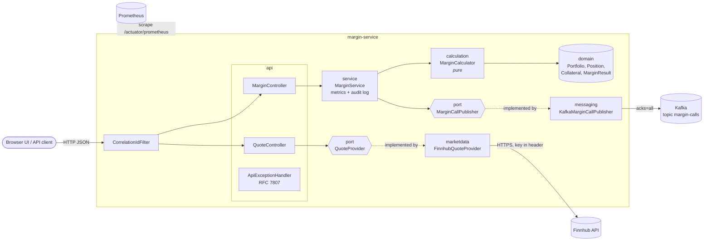
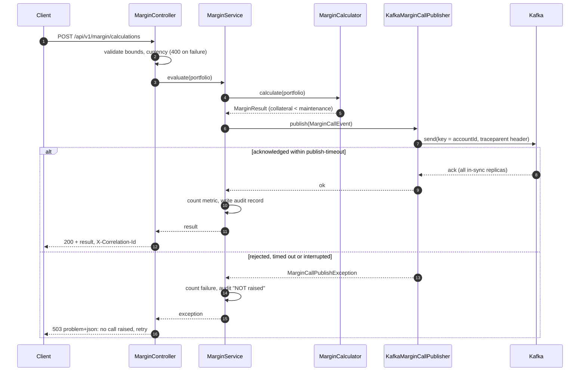

# Architecture

## Components

Ports and adapters ([ADR 0001](adr/0001-ports-and-adapters.md)): the margin model and domain have no framework,
transport or vendor dependencies, and `ArchitectureTest` enforces it.

## Raising a margin call

The response is only `200` once the broker has acknowledged the event
([ADR 0002](adr/0002-acknowledge-margin-call-before-responding.md)).

## Cross-cutting concerns

| Concern | Where |
|---|---|
| Input validation and limits | `MarginRequest` (Bean Validation), `Portfolio` invariants ([ADR 0005](adr/0005-bounded-inputs.md)) |
| Money arithmetic | `BigDecimal`, half-even, currency minor unit ([ADR 0003](adr/0003-decimal-arithmetic-and-rounding.md)) |
| Errors | `ApiExceptionHandler`: RFC 7807 problem details; internal causes logged, not returned |
| Correlation and tracing | `CorrelationIdFilter`, Micrometer Tracing; IDs on every log line and Kafka record |
| Audit | `audit.margin` logger, structured key-value pairs |
| Configuration | `MarginProperties`, `FinnhubProperties`: typed, validated at startup |
